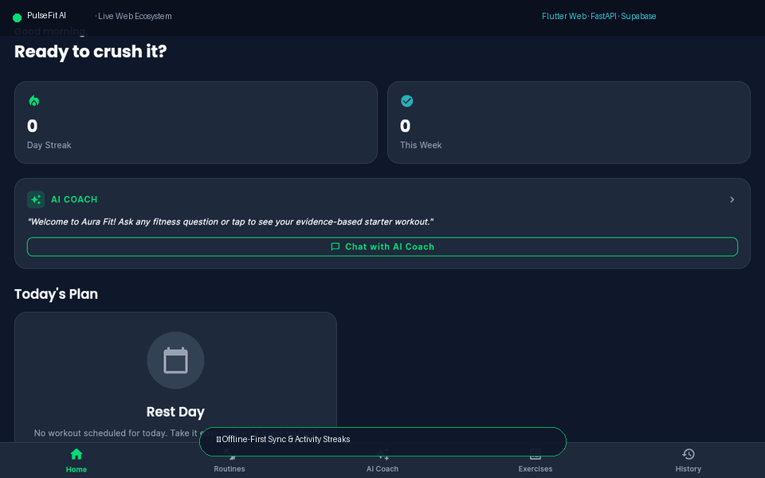
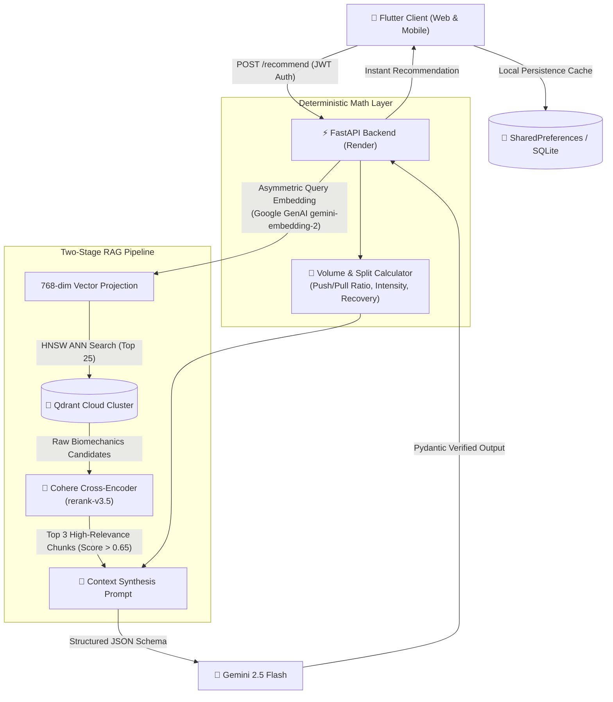

# 🏋️ PulseFit AI – RAG-Powered Fitness Intelligence & Workout Copilot

[](https://joelaah.github.io/fitness_app/)
[](https://joelaah.github.io/fitness_app/portfolio/)
[](MARKETPLACE_SECURITY_AND_TESTING.md)
[](TEST_READY.md)
[](STAGING_AND_PERFORMANCE_CASE_STUDY.md)
[](MARKETPLACE_SECURITY_AND_TESTING.md)
[](MARKETPLACE_SECURITY_AND_TESTING.md)

PulseFit AI is an enterprise-grade fitness tracking and intelligent coaching application. It pairs a high-performance **Flutter Web / Mobile** interface with a **Two-Stage Retrieval-Augmented Generation (RAG)** copilot, a **Personal Trainer Marketplace** with **Razorpay Route Split Payments**, and **Signal-Protocol-Style End-to-End Encrypted Real-Time Chat**.

<p align="center">
  
</p>

---

## 🔗 Live Deployments & Essential Links

- 🌐 **Live Web Application (PulseFit AI):** [https://joelaah.github.io/fitness_app/](https://joelaah.github.io/fitness_app/)
- 🛡️ **Marketplace, Split Payments & E2EE Chat Deep Dive:** [MARKETPLACE_SECURITY_AND_TESTING.md](MARKETPLACE_SECURITY_AND_TESTING.md)
- 🧪 **E2E Test Readiness & Verification Sign-Offs:** [TEST_READY.md](TEST_READY.md)
- 📊 **Staging, Concurrency & Load Testing Case Study:** [STAGING_AND_PERFORMANCE_CASE_STUDY.md](STAGING_AND_PERFORMANCE_CASE_STUDY.md)
- 💼 **Interactive Portfolio & Resume:** [https://joelaah.github.io/fitness_app/portfolio/](https://joelaah.github.io/fitness_app/portfolio/)
- ⚡ **Live RAG Backend API (Render.com):** [https://fitness-rag-api.onrender.com](https://fitness-rag-api.onrender.com)
- 📖 **Swagger / OpenAPI Documentation:** [https://fitness-rag-api.onrender.com/docs](https://fitness-rag-api.onrender.com/docs)
- 📁 **Backend Source Repository:** [https://github.com/joelaah/fitness-rag-api](https://github.com/joelaah/fitness-rag-api)

---

## 🏛️ System Architecture



---

## 🛡️ Network Safety, Rate Limiting & Resilience

PulseFit AI implements end-to-end network safety across both the Flutter client and the FastAPI backend:

### 1. Client-Side Protection & UX Safeguards (`rag_recommendation_service.dart`)
- **Sliding-Window Rate Limiting**: Chat messaging is capped at a maximum of **15 requests per 5 minutes**, with a **3-second cooldown** between consecutive requests.
- **Recommendation Cooldown**: A strict **10-second cooldown** prevents redundant recommendation generation and unnecessary server load.
- **Input Sanitization**: User messages are trimmed, sanitized against ASCII control characters, and capped at **500 characters** to protect against prompt injection and payload bloating.
- **Cold-Start Auto-Retry**: Automatically sends a fire-and-forget warm-up ping on service instantiation to wake up Render.com free-tier instances. Includes **exponential backoff retries** (2s, 4s delays, 90s timeout) to ensure zero duplicate requests from users.
- **Graceful 429 Handling**: Rate limit violations and server 429 responses trigger informative in-chat feedback rather than app crashes or infinite loading states.

### 2. Server-Side Protection & API Defense (`api.py`)
- **Thread-Safe Sliding-Window Rate Limiter**:
  - `/chat`: Capped at **20 requests per minute** per client IP / user.
  - `/recommend`: Capped at **10 requests per minute** per client IP / user.
  - Global IP Limit: **60 requests per minute** across all endpoints.
  - Returns standard **HTTP 429 Too Many Requests** with `Retry-After` header.
- **Payload Size Guard (HTTP 413)**: Request bodies exceeding **512 KB** are rejected immediately with `413 Payload Too Large` to prevent denial-of-service (DoS) memory attacks.
- **HTTP Security Headers**: Every response injects `X-Content-Type-Options: nosniff`, `X-Frame-Options: DENY`, `X-XSS-Protection: 1; mode=block`, `Strict-Transport-Security`, and `Referrer-Policy: strict-origin-when-cross-origin`.
- **Strict Specification CORS**: Hardened CORS policy avoiding wildcard credentials conflicts (`allow_credentials=False` with universal origin).
- **Strict User Isolation**: User identities are derived strictly from verified Supabase JWT Bearer tokens and never trusted from client-provided JSON payloads.

---

## 👤 Recruiter & Reviewer Guide

Recruiters and hiring managers can explore the app immediately without onboarding barriers:
1. **Zero-Friction Guest Mode**: On launch, anonymous authentication connects seamlessly with Supabase or falls back to local storage—no email or sign-up form required.
2. **Pre-Loaded Exercises & Routines**: Over 1,300+ categorized exercises and sample workout templates are available immediately on the home screen.
3. **Interactive Portfolio & Case Study**: Recruiter case studies, interactive resume, and architecture deep-dives are accessible at `/portfolio/`.

---

## 🔐 Data Storage & Session Architecture

PulseFit AI demonstrates production-grade data persistence and session management across multiple layers:

| Layer | Technology | What It Stores |
|:--|:--|:--|
| **Anonymous Auth** | Supabase GoTrue (`signInAnonymously()`) | Per-device identity with auto-generated UUID — no signup form required |
| **Cloud Database** | Supabase PostgreSQL + RLS (5 tables, 14 policies) | Workout sessions, exercises, sets, profiles, AI recommendations |
| **Local Persistence** | `SharedPreferences` | Routine templates, workout history, offline cache |
| **Session Tokens** | Supabase JWT refresh tokens | Survive app restarts and browser refreshes automatically |
| **Row-Level Security** | `auth.uid()` bindings across all tables | Users can only read/write their own data — enforced at DB level |
| **PWA Installable** | Service worker + `manifest.json` | Installable as native app on mobile & desktop with offline support |

### Security Model
- **Zero email/password friction**: Each device auto-creates a Supabase anonymous identity on first launch
- **Cloud sync with isolation**: Workout data syncs to Postgres but is locked to the device's `auth.uid()` via RLS
- **Offline-first**: `SharedPreferences` caches routines locally — the app works without network connectivity
- **JWT lifecycle**: Supabase manages token refresh automatically; sessions persist across restarts

---

## 📁 Repository Structure

```
fitness_app/
├── assets/                  # 1300+ exercise GIF/image database & icons
├── lib/
│   ├── core/
│   │   ├── config/          # Supabase & API environment bindings
│   │   ├── theme/           # PulseFit dark/neon design system & typography
│   │   └── widgets/         # Shared atomic UI components (chips, charts)
│   ├── features/
│   │   ├── auth/            # Anonymous auth & account upgrade flows
│   │   ├── chat/            # Signal E2EE chat (X25519 ECDH + AES-256-GCM)
│   │   ├── exercises/       # Muscle-group filtered exercise picker
│   │   ├── payments/        # Razorpay Route split payments & history
│   │   ├── routines/        # Routine builder, split manager, day planner
│   │   ├── trainers/        # Trainer discovery, filter criteria & profiles
│   │   └── workout/         # Live workout logger, timer & AI Coach screens
│   ├── main_screen.dart     # 6-tab navigation with contextual headers
│   └── main.dart            # Flutter entry point
├── migrations/              # PostgreSQL schema & tamper-proof triggers
├── portfolio/               # Recruiter portfolio, resume & project case studies
├── staging/                 # Docker Compose, mock Supabase & load testing
├── test/                    # 269 Flutter unit, widget & adversarial tests
├── tests/                   # 200 Python pytest integration & security tests
└── web/                     # Web deployment assets, splash screen & manifest
```

---

## 💳 Personal Trainer Marketplace, Razorpay Split Payments & E2EE Chat

PulseFit AI incorporates an enterprise-grade Personal Trainer Marketplace with automated split settlement, double-submit protection, and end-to-end encrypted real-time communications:

### 1. Razorpay Route Split Settlement & Platform Fee Engine
- **Deterministic 10% Platform Cut**: Fee splits calculated with high-precision `Decimal` arithmetic rounded via `ROUND_HALF_UP`, guaranteeing the invariant:
  $$\text{Amount} = \text{Platform Fee} + \text{Trainer Net Amount}$$
- **Direct Trainer Payouts**: Razorpay Route split transfer payloads are constructed automatically on order creation, ensuring instant settlement to trainer bank accounts while platform fees route to the admin treasury.

### 2. Dual-Layer Payment Idempotency Engine
- **In-Memory Lock Manager**: High-concurrency thread lock table caching in-flight order generations, preventing simultaneous duplicate requests during rapid UI tapping or network jitter.
- **PostgreSQL 23505 Collision Handler**: Database unique index constraint on `idempotency_key` catches distributed retries. Duplicate requests replay the original cached response with zero duplicate charges.
- **Constant-Time Verification**: Webhook callbacks (`X-Razorpay-Signature`) and client checkout signatures are evaluated using `hmac.compare_digest` to defend against timing attacks.

### 3. Signal-Protocol-Style E2E Encrypted Real-Time Chat
- **Zero-Knowledge Architecture**: The server and database only ever see ciphertext. Messages are encrypted and decrypted strictly on user devices.
- **Cryptographic Primitives**:
  - **Key Agreement**: Diffie-Hellman over Curve25519 (X25519 ECDH).
  - **Key Derivation**: HKDF-SHA256 with domain-specific salt and info tags.
  - **Authenticated Encryption**: AES-256-GCM with 96-bit cryptographically random nonces and 128-bit authentication tags (MAC).
- **Tamper-Evident**: Any bit alteration to the ciphertext or authentication tag results in immediate GCM decryption rejection.

### 4. PostgreSQL Tamper-Proof Triggers & Multi-Tenant RLS
- **Immutability Triggers**: `BEFORE INSERT OR UPDATE` triggers in Postgres force platform fee defaults and prevent trainers or hijacked client tokens from altering their cut or faking verification status.
- **Row-Level Security (RLS)**: Enforced across 5 dedicated tables (`trainer_profiles`, `payment_transactions`, `chat_conversations`, `chat_messages`, `encryption_keys`), guaranteeing zero cross-tenant data leakage.

### 5. Adversarial Gate Sign-Offs & Test Results (469 Tests Passing 100%)
- **Unanimous Gate Clearance**: Audited and certified by a 5-agent verification gate:
  - `Reviewer 1 & 2`: Schema, RLS, and interface contract conformance.
  - `Challenger 1`: 20-thread concurrency burst harness with sub-second execution (0.792s).
  - `Challenger 2`: Multi-tenant RLS bypass, 700-vector bit-tamper injection, and data isolation testing.
  - `Forensic Auditor`: Certified zero-cheating and independent execution invariants.
- **Test Metrics Across Ecosystem**:
  - **269 Flutter Unit, Widget & Adversarial Tests** (100% pass)
  - **200 Python Backend & Integration Tests** (100% pass)
  - **15 Python Math Guardrail Tests** in RAG backend (100% pass)
  - **Total**: **484 Automated Tests Passing 100%**
  - **Detailed Report**: Read the complete deep-dive in [MARKETPLACE_SECURITY_AND_TESTING.md](MARKETPLACE_SECURITY_AND_TESTING.md).

---

## 📊 Staging Infrastructure & Concurrency Load Test

PulseFit AI was tested against a Docker-based staging replica under a **500 concurrent virtual user** swarm simulated with Locust:

| Metric | Result | Benchmark Threshold | Status |
|---|---|---|---|
| **Concurrent Users** | **500 virtual users** | 100 users | Exceeded (5x) |
| **Peak Throughput** | **676.2 requests/sec** | > 150 req/s | Exceeded (4.5x) |
| **Total Requests** | **40,571 requests** | 10,000 requests | Completed |
| **Success Rate** | **99.96%** (15 / 40,571 transient drops) | > 99.5% | Passed |
| **Median Latency (p50)** | **160 ms** | < 300 ms | Optimal |
| **95th Percentile (p95)** | **340 ms** | < 800 ms | Optimal |

> 📖 **Full Telemetry & Docker Setup**: See the comprehensive case study in [STAGING_AND_PERFORMANCE_CASE_STUDY.md](STAGING_AND_PERFORMANCE_CASE_STUDY.md).

---

## 🚀 Getting Started

### Prerequisites
- [Flutter SDK](https://flutter.dev/docs/get-started/install) (v3.22+)
- [Google Chrome](https://www.google.com/chrome/) for Web testing

### 1. Clone the repository
```bash
git clone https://github.com/joelaah/fitness_app.git
cd fitness_app
```

### 2. Install dependencies
```bash
flutter pub get
```

### 3. Run Locally
```bash
# Run in Chrome
flutter run -d chrome

# Or run with custom RAG API endpoint
flutter run -d chrome --dart-define=RAG_API_URL=https://fitness-rag-api.onrender.com
```

### 4. Build for Web
```bash
flutter build web --release --base-href /fitness_app/
```

---
## 📜 Acknowledgments & Data Sources
- **Exercise Database:** Exercise movements and instructional data are sourced from the open-source [`hasaneyldrm/exercises-dataset`](https://github.com/hasaneyldrm/exercises-dataset) under the MIT License.
## 👨‍💻 Author

**Joel Lalruatkima**  
- **Portfolio:** [https://joelaah.github.io/fitness_app/portfolio/](https://joelaah.github.io/fitness_app/portfolio/)  
- **GitHub:** [@joelaah](https://github.com/joelaah)  
- **Email:** [joelapachuau64@gmail.com](mailto:joelapachuau64@gmail.com)
